<p align="center">
  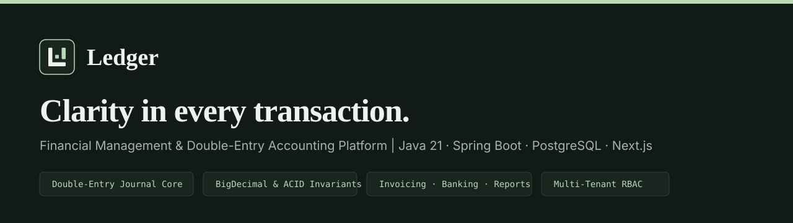
</p>

# Ledger

**Clarity in every transaction.**

Understand your finances. Manage your business with confidence.

Ledger is a browser-based financial management and double-entry accounting platform built with **Java 21**, **Spring Boot**, **Next.js**, **TypeScript**, and **PostgreSQL**. Engineered as a modular monolith portfolio application by [Dandi Setiawan](https://www.dandisetiawan.id/), Ledger focuses on deterministic financial calculations, normalized relational integrity, explicit ACID transaction boundaries, and auditable business workflows.

> **Scope Notice:** Ledger is an independent software engineering portfolio project. It does not claim regulatory accounting certification, statutory tax-filing compliance, commercial adoption, or third-party security audit certification.

---

## Live Application Screenshots

All screenshots below were captured directly from the running Ledger application using the seeded synthetic demonstration workspace (**Nusa Karsa Studio**, six months of Jakarta digital agency transactions).

### Public Product Surface & Executive Overview

| Public Landing Page | Financial Overview Workspace |
| --- | --- |
| 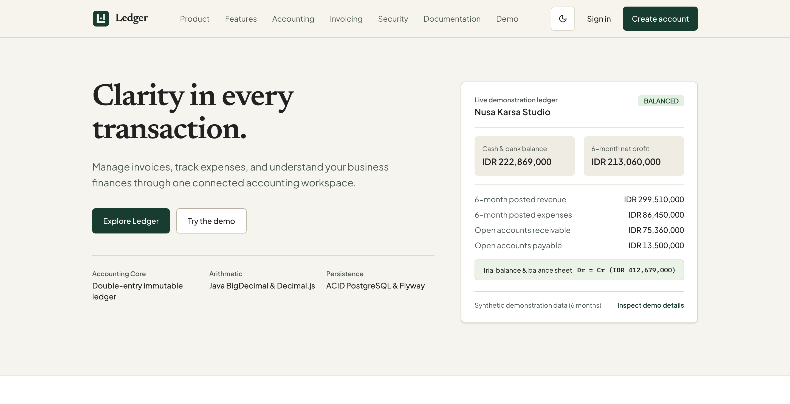 | 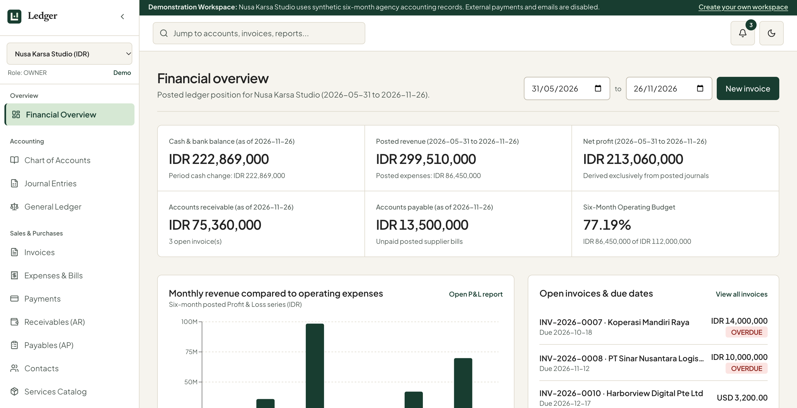 |

### Core Double-Entry Accounting Engine

| Chart of Accounts | General Ledger (Running Balances) |
| --- | --- |
| 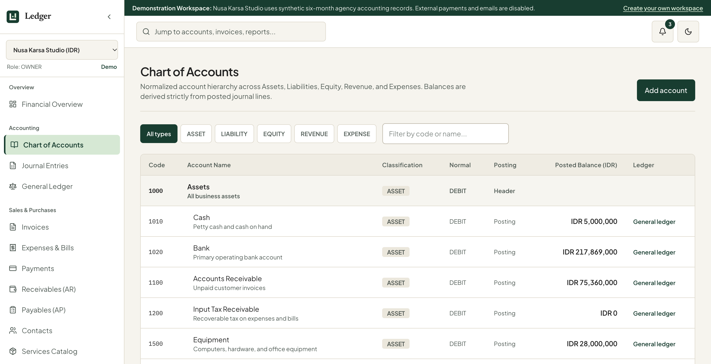 | 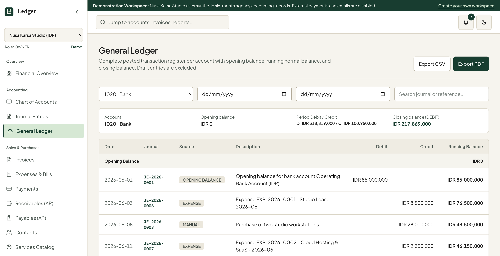 |

| Manual Journal Entry Editor | Profit and Loss Statement |
| --- | --- |
| 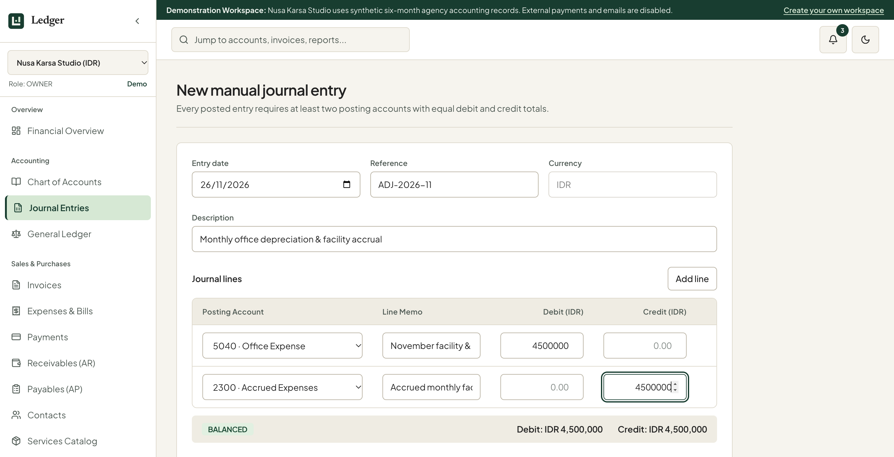 | 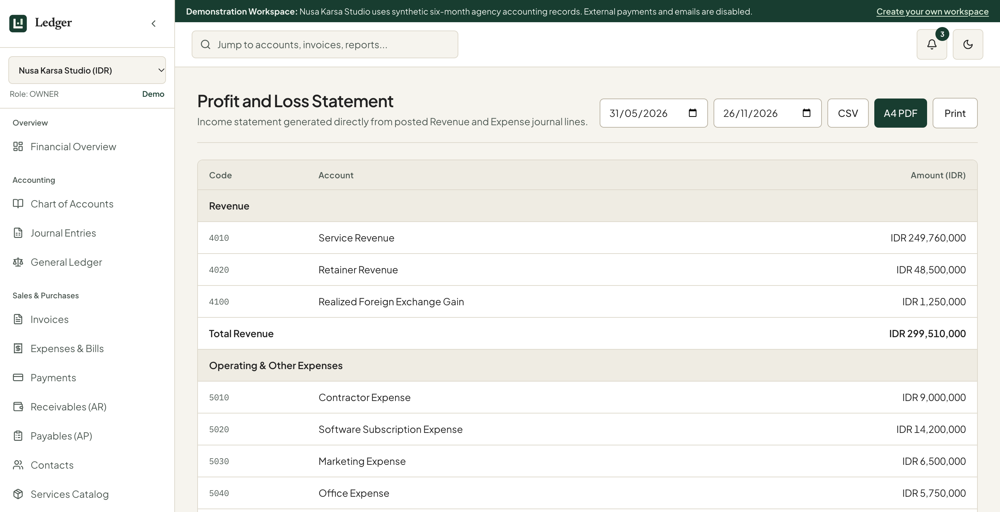 |

### Invoicing, Expenses, Reconciliation & Planning

| Customer Invoices & Multi-Currency | Printable Invoice View & A4 PDF |
| --- | --- |
| 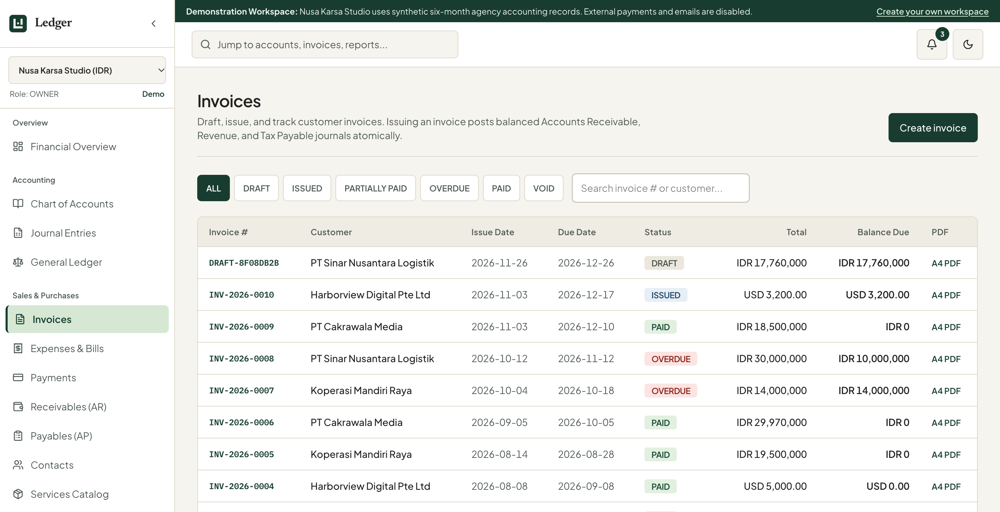 | 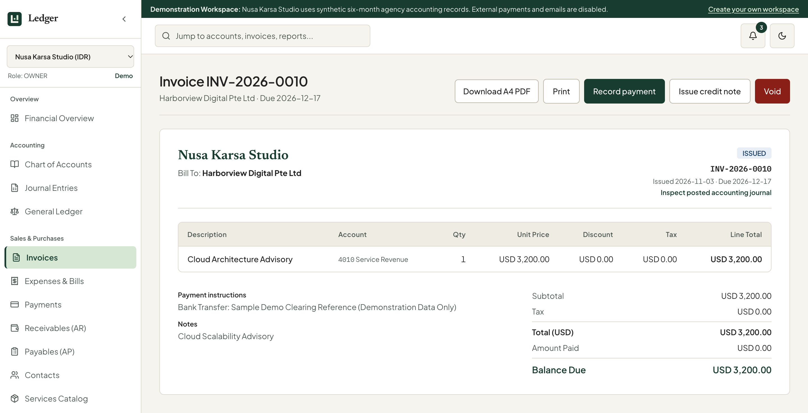 |

| Expenses & Supplier Bills | Deterministic Bank Reconciliation |
| --- | --- |
| 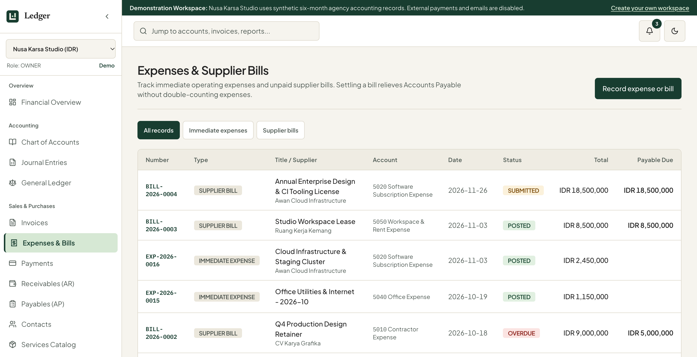 | 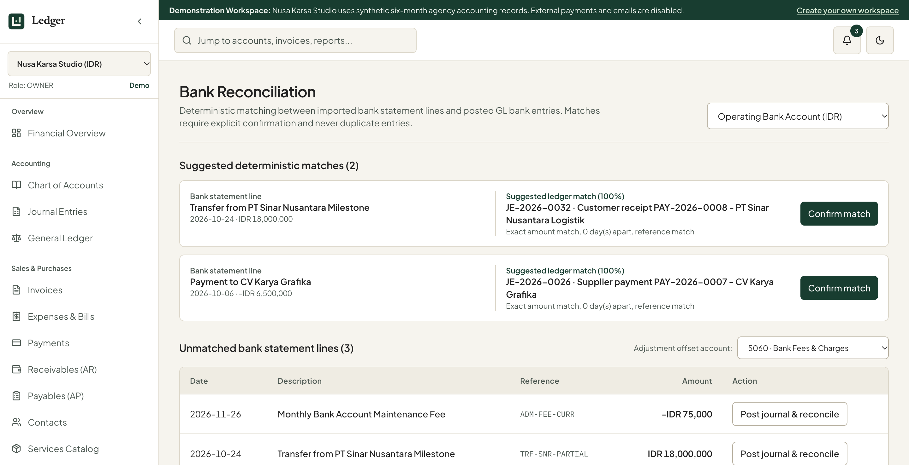 |

| Accounts Receivable Aging (GL Reconciled) | Balance Sheet (`Assets = Liabilities + Equity`) |
| --- | --- |
| 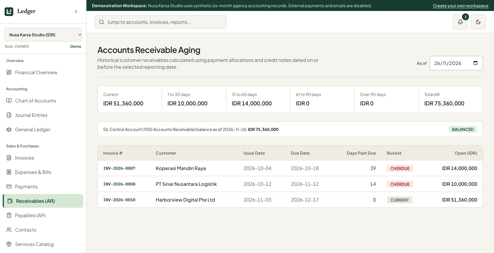 | 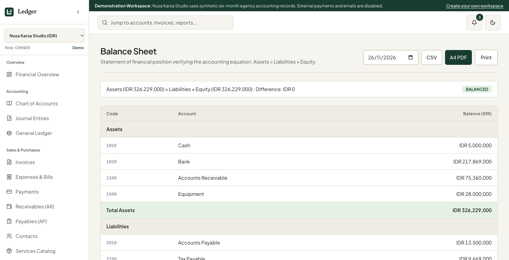 |

| Operating Budgets & Variance | Responsive Mobile Workspace (`390px`) |
| --- | --- |
| 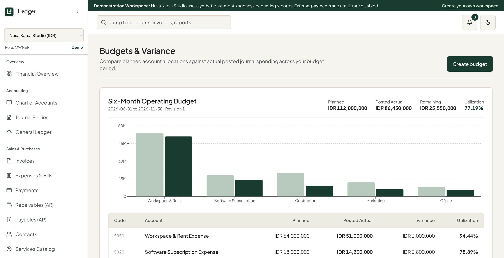 | 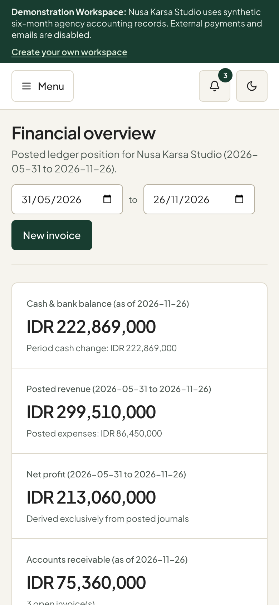 |

---

## Core Capabilities

- **Double-Entry Bookkeeping Engine:** Atomic balanced journals (`SUM(debit) == SUM(credit)`), immutable posted entries, linked reversal trails, and hierarchical Chart of Accounts where balances are derived exclusively from posted lines.
- **Accounting Period Controls:** Fiscal years, period closing guards blocking backdated postings, and role-restricted audited period reopening.
- **Invoicing, Credit Notes & A4 PDFs:** Draft, issue, partial payment, overdue tracking, credit notes, void flows, tax-exclusive and tax-inclusive calculations, concurrent gap-free document numbering, and server-side A4 PDF generation via OpenPDF.
- **Expenses & Supplier Bills:** Clear separation between immediate cash/bank expenses and unpaid Accounts Payable supplier bills so bill settlement relieves AP without double-counting expenses.
- **Payments & Multi-Currency Settlements:** Idempotent payment processing (`Idempotency-Key`), pessimistic row locking preventing over-allocation, unallocated customer credit liability handling, and automatic realized foreign exchange gain/loss postings.
- **Bank CSV Import & Reconciliation:** Custom column mapping, validation previews, SHA-256 duplicate line fingerprinting, deterministic match suggestions requiring explicit user confirmation, unmatch flows, and adjustment journals.
- **Reconciled Financial Statements:** Trial Balance, Profit and Loss, Balance Sheet verifying `Assets = Liabilities + Equity`, Direct Cash Flow excluding internal cash transfers, and historical AR/AP aging reconciled against GL control accounts (`1100` / `2010`), all exportable to CSV and A4 PDF.
- **Budgets, Approvals & Audit Trail:** Operating budgets vs. posted actuals, approval workflows with backend-enforced separation of duties, and an append-only financial audit log.

---

## Architecture Overview

Ledger uses a **modular monolith** architecture organized by business domain inside `backend/src/main/java/com/ledger/` (`identity`, `organization`, `accounting`, `journal`, `contact`, `invoice`, `expense`, `payment`, `banking`, `reconciliation`, `budget`, `reporting`, `approval`, `audit`, `document`, `notification`, `demo`, and `shared`).

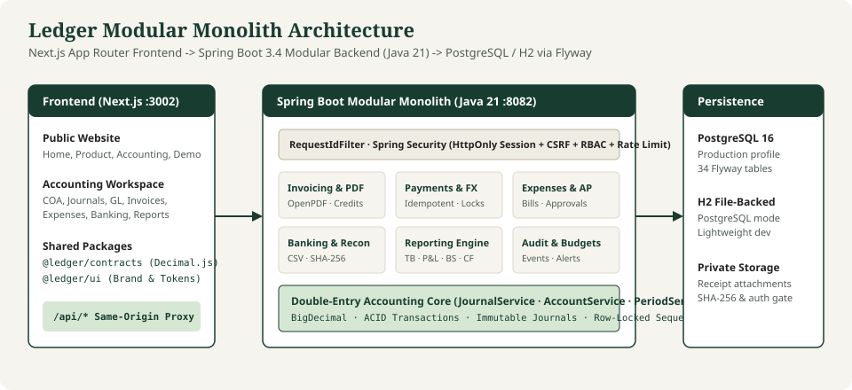

### Database Schema (34 Normalized Tables)

Flyway manages versioned migrations (`V1__init_schema.sql`, `V2__seed_currencies.sql`) with explicit foreign keys, `DECIMAL(19,4)` / `DECIMAL(19,8)` numeric columns, check constraints, unique constraints, and Hibernate schema validation (`ddl-auto: validate`).

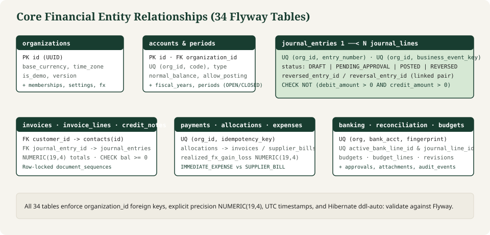

### Accounting Workflow Pipeline

Every business document translates into balanced, immutable journal entries in a single database transaction.

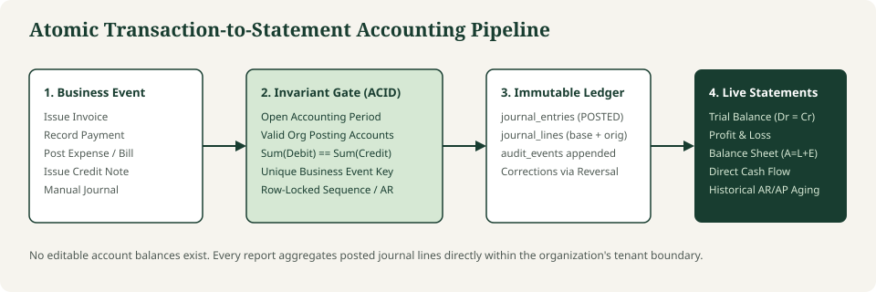

#### Concrete Journal Examples

| Business Event | Debit Entry | Credit Entry |
| --- | --- | --- |
| Issue IDR 10,000,000 service invoice (+11% tax) | `1100 Accounts Receivable` IDR 11,100,000 | `4010 Service Revenue` IDR 10,000,000<br>`2100 Tax Payable` IDR 1,100,000 |
| Receive IDR 4,000,000 partial transfer | `1020 Bank` IDR 4,000,000 | `1100 Accounts Receivable` IDR 4,000,000 |
| Settle USD 5,000 invoice booked at 15,800 when settled at 16,050 | `1020 Bank` IDR 80,250,000 | `1100 Accounts Receivable` IDR 79,000,000<br>`4100 Realized FX Gain` IDR 1,250,000 |
| Record unpaid supplier bill (IDR 8,500,000) | `5050 Workspace & Rent Expense` IDR 8,500,000 | `2010 Accounts Payable` IDR 8,500,000 |
| Settle supplier bill from Bank | `2010 Accounts Payable` IDR 8,500,000 | `1020 Bank` IDR 8,500,000 |

---

## Financial Invariants & Security Model

### Mandatory Financial Invariants
1. **Zero Floating-Point Arithmetic:** All backend monetary math uses `java.math.BigDecimal` with explicit `RoundingMode.HALF_UP` and currency-specific scales (`0` for IDR/JPY, `2` for USD/EUR/SGD/GBP/AUD). Frontend invoice previews use `decimal.js`; the backend always recalculates and enforces authoritative totals.
2. **Double-Entry Equality:** Every posted journal requires at least two posting accounts, zero header-account postings, strictly positive single-sided lines, and exact base-currency equality (`SUM(debit) == SUM(credit)`).
3. **Immutability & Reversals:** Posted journals cannot be edited or deleted. Corrections create linked reversal entries (`reverses_journal_id` / `reversed_by_journal_id`).
4. **Concurrency & Idempotency:** Document sequence generation (`INV-YYYY-NNNN`, `JE-YYYY-NNNN`, `PAY-YYYY-NNNN`) and payment allocations acquire `PESSIMISTIC_WRITE` row locks alongside `@Version` optimistic locking and `Idempotency-Key` payload hashing.

### Security Architecture
- **Authentication:** BCrypt (strength 12) password hashing, server-backed session tokens stored in `HttpOnly`, `SameSite=Lax` cookies (`LEDGER_SESSION`), login rate limiting, and session revocation.
- **CSRF Protection:** Spring Security `CookieCsrfTokenRepository` (`XSRF-TOKEN` cookie validated against `X-XSRF-TOKEN` header on all state-changing requests).
- **Authorization & Isolation:** Organization membership verification on every tenant query, role-based access control (`OWNER`, `ADMIN`, `ACCOUNTANT`, `FINANCE_STAFF`, `VIEWER`), separation of duties (requesters cannot approve their own requests), and authorized attachment downloads with MIME/size/path-traversal validation.

See [docs/SECURITY.md](docs/SECURITY.md) and [docs/THREAT_MODEL.md](docs/THREAT_MODEL.md) for full details.

---

## Technology Stack

| Layer | Technologies |
| --- | --- |
| **Backend** | Java 21, Spring Boot 3.4.3, Spring Web MVC, Spring Data JPA, Hibernate, Spring Security, Flyway, OpenPDF 2.0.3, Apache Commons CSV 1.13, Springdoc OpenAPI 2.8, Maven Wrapper (`./mvnw`) |
| **Frontend** | Next.js 15 (App Router), React 19, TypeScript (strict), Tailwind CSS v4, TanStack Query, Recharts, Lucide Icons, Motion, `decimal.js`, Vitest, React Testing Library |
| **Database** | PostgreSQL 16 (production-oriented profile & CI Testcontainers) and H2 file-backed PostgreSQL-compatibility mode (lightweight local profile) |
| **Infrastructure & CI** | Docker, Docker Compose, Nginx reverse proxy config, GitHub Actions CI |

---

## Quick Start

### Prerequisites
- **Java 21** (Maven Wrapper `backend/mvnw` is bundled; global Maven is not required)
- **Node.js 22+** and **pnpm 10+**

### 1. Lightweight Local Profile (H2, No Docker Required)

```bash
# Install frontend workspace dependencies
pnpm install

# Start backend (port 8082, H2 file-backed) and frontend (port 3002)
make dev
# or directly:
./scripts/dev.sh
```

Open:
- **Public website:** http://localhost:3002
- **Interactive demo:** http://localhost:3002/demo (one-click launch into **Nusa Karsa Studio**)
- **Backend API & Swagger UI:** http://localhost:8082/swagger-ui.html
- **Health check:** http://localhost:8082/actuator/health

To stop both Ledger services cleanly:

```bash
make stop
```

### 2. PostgreSQL Profile & Docker Compose

Copy `.env.example` to `.env` and start with Docker Compose (includes PostgreSQL 16, Spring Boot backend, and Next.js frontend):

```bash
cp .env.example .env
docker compose up --build
```

Or run the Spring Boot backend against a local PostgreSQL 16 instance:

```bash
cd backend
SPRING_PROFILES_ACTIVE=postgres \
  LEDGER_DB_URL=jdbc:postgresql://localhost:5432/ledger \
  LEDGER_DB_USERNAME=ledger \
  LEDGER_DB_PASSWORD=ledger_dev_password \
  ./mvnw spring-boot:run
```

---

## Demonstration Workspace

Ledger seeds an isolated synthetic agency dataset (**Nusa Karsa Studio**, Jakarta, base currency `IDR`) entirely through the application's real accounting services so every number reconciles cleanly:

- **Six months of posted activity:** Paid, partially paid, overdue, draft, and USD foreign-currency invoices; automatic realized FX gain on USD settlement; credit note issuance; recurring operating expenses; unpaid supplier bills; and partial AP settlement.
- **Governance & Reconciliation:** One pending approval submitted by a separate finance officer to demonstrate separation of duties, plus imported bank statement lines ready for deterministic match confirmation.
- **Isolation:** Demo sessions authenticate as a dedicated demo account bound strictly to the synthetic organization with no access to user-created tenants or external payment/email networks.

---

## Running Tests & Verification

```bash
# Backend unit, accounting invariant, reporting, concurrency, and security tests (H2)
cd backend && ./mvnw -B test

# PostgreSQL 16 integration tests (requires Docker / runs automatically in GitHub Actions CI)
cd backend && ./mvnw -B test -Dgroups=postgres-integration

# Frontend typecheck, lint, unit tests, and production build
pnpm typecheck:web
pnpm lint:web
pnpm test:web
pnpm build:web
```

See [IMPLEMENTATION_STATUS.md](IMPLEMENTATION_STATUS.md) and [docs/TESTING.md](docs/TESTING.md) for exact verification scope and environment details.

---

## Documentation

| Document | Description |
| --- | --- |
| [docs/ARCHITECTURE.md](docs/ARCHITECTURE.md) | Modular monolith design, boundaries, and request lifecycle |
| [docs/ACCOUNTING_ENGINE.md](docs/ACCOUNTING_ENGINE.md) | Double-entry posting rules, reversals, FX, and period close |
| [docs/FINANCIAL_INVARIANTS.md](docs/FINANCIAL_INVARIANTS.md) | Precision rules, locking, idempotency, and GL reconciliation |
| [docs/DATABASE.md](docs/DATABASE.md) | Normalized 34-table schema, indexes, and Flyway migration discipline |
| [docs/API.md](docs/API.md) | REST endpoints, CSRF, idempotency headers, and RFC 9457 errors |
| [docs/SECURITY.md](docs/SECURITY.md) | Authentication, cookies, RBAC matrix, and upload validation |
| [docs/THREAT_MODEL.md](docs/THREAT_MODEL.md) | STRIDE-oriented financial threat analysis and mitigations |
| [docs/TESTING.md](docs/TESTING.md) | Automated backend, frontend, and PostgreSQL integration test suites |
| [docs/DEVELOPMENT.md](docs/DEVELOPMENT.md) | Local H2 and PostgreSQL development workflows |
| [docs/DEPLOYMENT.md](docs/DEPLOYMENT.md) | Container build, Nginx proxy, and production checklist |
| [docs/DESIGN_SYSTEM.md](docs/DESIGN_SYSTEM.md) | Palette, WCAG AA contrast verification, typography, and motion |
| [docs/DEMO.md](docs/DEMO.md) | Synthetic Nusa Karsa Studio agency dataset and walkthrough |
| [docs/ROADMAP.md](docs/ROADMAP.md) | Potential post-v0.1 enhancements |
| [CHANGELOG.md](CHANGELOG.md) | Initial release notes |
| [IMPLEMENTATION_STATUS.md](IMPLEMENTATION_STATUS.md) | Verified test results, capabilities matrix, and known limitations |

---

## Known Limitations

- **Portfolio Scope:** Not certified for statutory Indonesian PSAK / IFRS tax filing, payroll withholding, or automated e-Faktur submission.
- **No Live Bank Feeds or Payment Gateways:** Bank statements are imported via mapped CSV files; external payment execution and outbound email delivery are intentionally omitted.
- **Local Machine Profile:** Local development on machines without Docker runs the H2 file-backed profile; full PostgreSQL 16 + Flyway + Testcontainers validation runs via Docker / GitHub Actions CI.
- **Licensing:** No open-source license has been added to this repository; all rights remain reserved by the author unless explicitly licensed later.

---

## Author

**Dandi Setiawan**
Website: [https://www.dandisetiawan.id/](https://www.dandisetiawan.id/)
Repository: [https://github.com/dandisetiawanco/Ledger](https://github.com/dandisetiawanco/Ledger)
