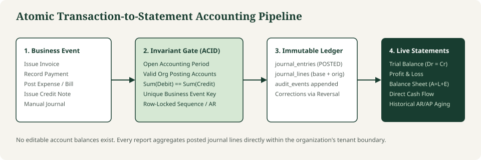
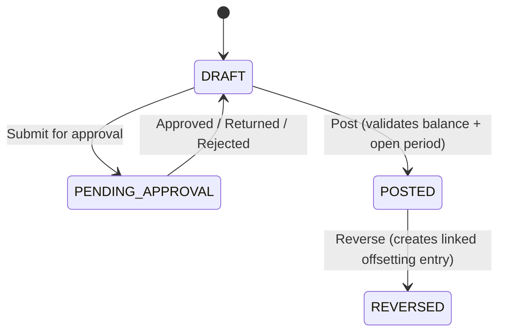

# Double-Entry Accounting Engine

Ledger derives every account balance and every financial statement from posted double-entry journal lines. No balance column exists that users can edit directly.

## Account Classifications & Normal Balances

| Classification | Normal Balance | Increases With | Decreases With | Contra Example |
|---|---|---|---|---|
| `ASSET` | `DEBIT` | Debit | Credit | `1510 Accumulated Depreciation` (Credit normal) |
| `LIABILITY` | `CREDIT` | Credit | Debit | - |
| `EQUITY` | `CREDIT` | Credit | Debit | `3030 Owner Drawings` (Debit normal) |
| `REVENUE` | `CREDIT` | Credit | Debit | - |
| `EXPENSE` | `DEBIT` | Debit | Credit | - |

On the Balance Sheet, section totals use classification-level sign (`Debit - Credit` for Assets/Expenses; `Credit - Debit` for Liabilities/Equity/Revenue), so contra accounts naturally reduce their parent classification total and preserve `Assets = Liabilities + Equity`.

## Journal Entry Lifecycle

- **Draft**: Editable and deletable; excluded from all official financial reports and General Ledger balances.
- **Pending Approval**: Frozen pending an authorized approver decision.
- **Posted**: Permanently immutable. Neither headers nor lines can be edited or deleted.
- **Reversed**: Remains in the ledger together with its linked reversal entry (`reversed_entry_id` / `reversal_entry_id`), netting to zero while preserving full historical auditability.

## Automated Posting Matrix

| Business Event | Debit Account(s) | Credit Account(s) |
|---|---|---|
| Service invoice issued (IDR 10M, 0% tax) | `1100 Accounts Receivable` (10M) | `4010 Service Revenue` (10M) |
| Taxable invoice issued (IDR 9M net + 990k tax) | `1100 Accounts Receivable` (9.99M) | `4010 Service Revenue` (9M), `2100 Tax Payable` (990k) |
| Customer partial payment (IDR 4M) | `1020 Bank` (4M) | `1100 Accounts Receivable` (4M) |
| Customer overpayment (IDR 9.5M on 8.991M due) | `1020 Bank` (9.5M) | `1100 AR` (8.991M), `2200 Customer Deposits` (509k) |
| Credit note issued | `4010 Service Revenue`, `2100 Tax Payable` | `1100 Accounts Receivable` |
| Immediate operating expense (IDR 500k) | `5070 Operating Expense` (500k) | `1020 Bank` (500k) |
| Supplier bill posted (IDR 2M) | `5010 Contractor Expense` (2M) | `2010 Accounts Payable` (2M) |
| Supplier bill settled (IDR 2M) | `2010 Accounts Payable` (2M) | `1020 Bank` (2M) |
| Foreign USD invoice settled at higher rate | `1020 Bank` (settlement base) | `1100 AR` (historical base), `4100 Realized FX Gain` (diff) |

## Accounting Period Controls

Every posting resolves the `AccountingPeriod` covering `entry_date`. Closed periods reject postings with HTTP 422 (`PERIOD_CLOSED`). Closing a period acquires a `PESSIMISTIC_WRITE` row lock and checks that zero `DRAFT` or `PENDING_APPROVAL` journals exist inside that period. Reopening requires `OWNER` or `ADMIN` permissions, a mandatory written reason, and writes a `PERIOD_REOPENED` audit event.

## Year-End Reporting Approach

Balance Sheet reports automatically include unclosed cumulative net earnings (`Revenue - Expenses` up to `asOfDate`) under Equity as `Current Period Net Earnings`, ensuring `Assets = Liabilities + Equity` holds on any date. Statutory automated fiscal-year closing journals to Retained Earnings are documented as a roadmap milestone rather than claimed as statutory compliance.
