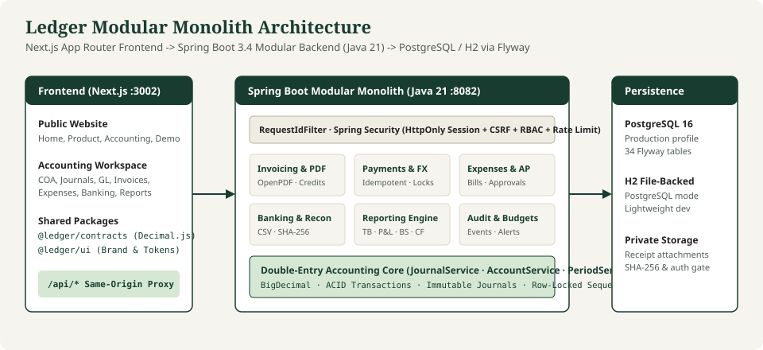
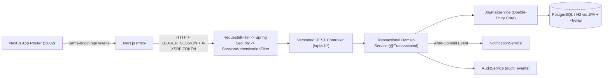

# System Architecture

Ledger is built as a **modular monolith** backed by a normalized relational database, paired with a strict TypeScript Next.js App Router frontend.

## Architectural Rationale

A financial accounting system depends heavily on cross-module atomic consistency: issuing an invoice must allocate a gap-free sequential number, freeze invoice totals, and post balanced double-entry journal lines inside a single ACID database transaction. Splitting these workflows into separate microservices would require distributed sagas and introduce eventual consistency windows where receivables and general ledger balances diverge.

Ledger organizes capabilities into 17 cohesive Java packages under `com.ledger.*`:

| Module | Package | Responsibility |
|---|---|---|
| Identity & Security | `com.ledger.identity` | User accounts, BCrypt password hashing, DB-backed HTTP-only sessions, CSRF, CORS, login rate limiting |
| Organizations | `com.ledger.organization` | Multi-tenant workspaces, 6 RBAC roles, financial settings, manual FX rates, initializer hooks |
| Accounting | `com.ledger.accounting` | Chart of Accounts hierarchy, normal balances, fiscal years, open/close/reopen accounting periods |
| Journal & Ledger | `com.ledger.journal` | Double-entry engine, balanced postings, immutability, linked reversals, General Ledger queries |
| Contacts & Catalog | `com.ledger.contact` | Unified customers/suppliers with ledger-derived summaries, service catalog |
| Invoicing | `com.ledger.invoice` | Invoice lifecycle, tax/discount math, credit notes, A4 OpenPDF rendering |
| Payments | `com.ledger.payment` | Customer receipts, supplier settlements, idempotency, FX realization, row-locked allocations |
| Expenses | `com.ledger.expense` | Immediate operating expenses, unpaid supplier bills, expense categories |
| Banking | `com.ledger.banking` | Manual bank/cash accounts, configurable CSV statement importer, SHA-256 deduplication |
| Reconciliation | `com.ledger.reconciliation` | Deterministic matching, explicit confirmation, adjustment journal creation, unmatch history |
| Budgets | `com.ledger.budget` | Annual/monthly account budgets evaluated directly against posted journal actuals |
| Reporting | `com.ledger.reporting` | Trial Balance, Profit & Loss, Balance Sheet, Direct Cash Flow, Historical AR/AP Aging, CSV/PDF export |
| Approvals | `com.ledger.approval` | Configurable approval queue with separation of duties |
| Audit | `com.ledger.audit` | Append-oriented financial audit trail with request correlation IDs |
| Documents | `com.ledger.document` | Validated private attachment uploads and organization-authorized downloads |
| Notifications | `com.ledger.notification` | After-commit domain event alerts and idempotent scheduled invoice reminders |
| Demo | `com.ledger.demo` | Isolated synthetic 6-month agency seeder using real accounting services |

## Request & Transaction Flow

## Engineering Fundamentals Demonstrated

- **Object-Oriented Encapsulation**: Domain entities (`Invoice`, `JournalEntry`, `Payment`, `AccountingPeriod`) own state transitions (`markIssued`, `applyPayment`, `markReversed`, `close`) so invalid states cannot be assembled by arbitrary setters.
- **Spring Dependency Injection**: Constructor injection across all services and controllers; `OrganizationInitializer` demonstrates clean extension without circular dependencies between `organization`, `accounting`, and `expense`.
- **Hibernate Persistence & Flyway**: `spring.jpa.open-in-view: false` prevents accidental lazy queries during JSON serialization; `spring.jpa.hibernate.ddl-auto: validate` guarantees Flyway migrations are the single source of truth for schema evolution.
- **Domain Events**: Critical accounting postings execute synchronously inside the caller's database transaction. Non-critical notifications subscribe via `@TransactionalEventListener(phase = TransactionPhase.AFTER_COMMIT)` with `REQUIRES_NEW` so alerts only emit when financial commits succeed.
