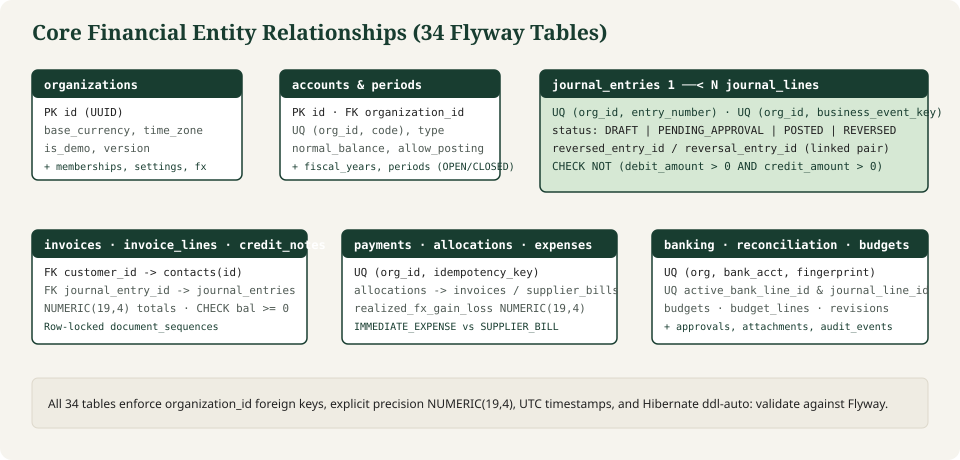

# Database Design & Migrations

Ledger uses a normalized 34-table relational schema managed exclusively through versioned Flyway migrations (`backend/src/main/resources/db/migration/`).

## Schema Principles

- **Flyway Single Source of Truth**: `spring.jpa.hibernate.ddl-auto` is set to `validate` across all profiles (H2 dev, H2 tests, and PostgreSQL). Hibernate never mutates schema automatically.
- **Cross-Database Portability**: Migrations `V1__init_schema.sql` and `V2__seed_currencies.sql` use standard SQL types (`UUID`, `VARCHAR`, `NUMERIC(19,4)`, `DATE`, `TIMESTAMP WITH TIME ZONE`) compatible with PostgreSQL 16 and H2 2.x PostgreSQL mode.
- **Timestamps & Dates**: Audit and system timestamps store UTC (`TIMESTAMP WITH TIME ZONE`), while accounting dates (`entry_date`, `issue_date`, `due_date`, `payment_date`, `transaction_date`) store calendar `DATE` values anchored to the organization's accounting calendar.
- **Organization Isolation**: Every tenant-owned table includes `organization_id UUID NOT NULL REFERENCES organizations(id) ON DELETE CASCADE` and composite indexes prefixed with `organization_id`.
- **Optimistic Locking**: Core mutable entities include `version BIGINT NOT NULL DEFAULT 0` mapped with JPA `@Version`.

## Table Groups

1. **Identity & Multi-Tenancy**: `users`, `organizations`, `organization_memberships`, `user_sessions`, `financial_settings`, `currencies`, `exchange_rates`
2. **Accounting Core**: `fiscal_years`, `accounting_periods`, `accounts`, `journal_entries`, `journal_lines`, `document_sequences`
3. **Commercial & Payables**: `contacts`, `catalog_items`, `invoices`, `invoice_lines`, `credit_notes`, `expense_categories`, `expenses`, `payments`, `payment_allocations`
4. **Banking & Planning**: `bank_accounts`, `bank_statement_imports`, `bank_statement_lines`, `reconciliation_records`, `budgets`, `budget_lines`, `budget_revisions`
5. **Governance & Operations**: `approval_requests`, `attachments`, `notifications`, `audit_events`, `idempotency_records`

## Database Profiles

- **Lightweight (`h2`)**: File-backed H2 (`./data/ledger`) in PostgreSQL compatibility mode for zero-setup local development on memory-constrained laptops.
- **Production-oriented (`postgres`)**: PostgreSQL 16 with HikariCP connection pooling, verified separately through Testcontainers (`PostgresIntegrationIT`). H2 test runs are never claimed as PostgreSQL verification.
